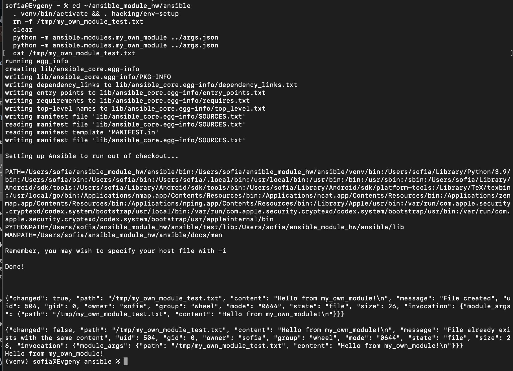
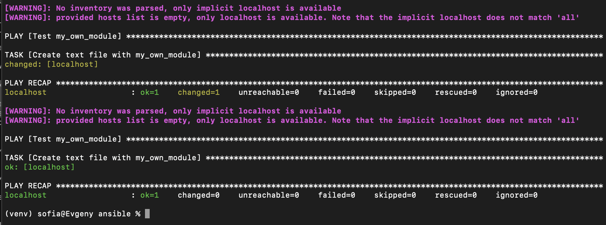
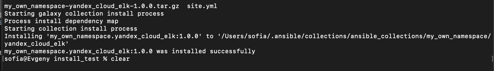
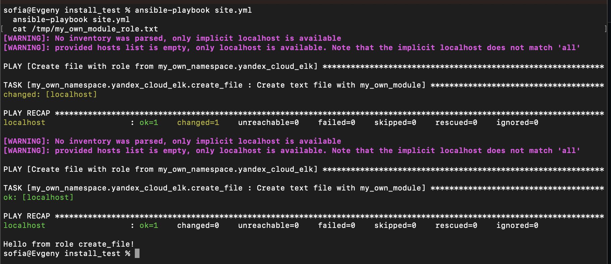

# Домашнее задание «Создание собственных модулей» - Юртаева Софья Вячеславовна

## Ссылки

- Collection: [my_own_namespace/yandex_cloud_elk](my_own_namespace/yandex_cloud_elk)
- Архив: [my_own_namespace-yandex_cloud_elk-1.0.0.tar.gz](https://github.com/YurtaevaSofia/my_own_collection/releases/download/1.0.0/my_own_namespace-yandex_cloud_elk-1.0.0.tar.gz) (релиз [1.0.0](https://github.com/YurtaevaSofia/my_own_collection/releases/tag/1.0.0))

## Окружение

Использована ветка `stable-2.15` репозитория Ansible, т.к. локально установлен Python 3.9
(ветки новее требуют Python >= 3.10).

## Структура репозитория

```
my_own_namespace/yandex_cloud_elk/        # collection
├── galaxy.yml
├── meta/runtime.yml
├── plugins/modules/my_own_module.py      # модуль: создаёт файл path с содержимым content
└── roles/create_file/                    # single task role
    ├── defaults/main.yml                 # defaults для path и content
    └── tasks/main.yml
playbook/site.yml                         # playbook, использующий роль
```

## Модуль

[`my_own_module.py`](my_own_namespace/yandex_cloud_elk/plugins/modules/my_own_module.py) создаёт текстовый файл
на целевом хосте по пути `path` с содержимым `content`. Если файл уже существует с тем же
содержимым, возвращает `changed: false`. Поддерживает check mode.

## Шаг 4. Проверка модуля локально

```bash
python -m ansible.modules.my_own_module args.json
```



## Шаг 6. Проверка идемпотентности через playbook



## Шаг 15. Установка collection из локального архива

```bash
ansible-galaxy collection install my_own_namespace-yandex_cloud_elk-1.0.0.tar.gz
```



## Шаг 16. Запуск playbook

```bash
ansible-playbook site.yml
```


